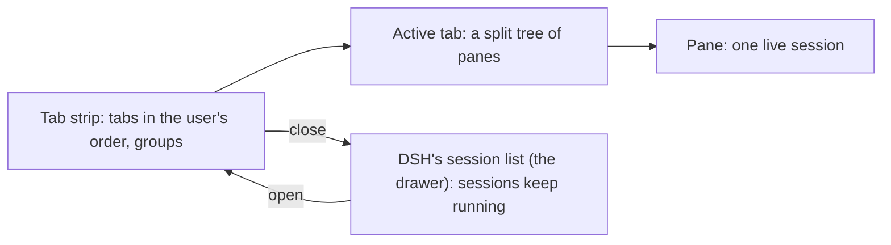

# Design

dsh-tabs is one DSH bundle with two halves: the Host half ([`index.js`](index.js)) stores the tabs,
and the Client half ([`client.js`](client.js)) is the Tabs page. Neither half imports a Harness
package; the client uses the browser module table's React and the theme's `--dsw-alias-*` tokens.

## The model



- **Tabs** are kept in the user's order. Opening adds a tab at the end, ungrouped. Only
  opening, closing, dragging and grouping change the order; showing a tab (click, ⌥1…9, ⌥[ ⌥])
  never does.
- A **tab** is a tree: a leaf pane holds one session, and a split (`row` or `col`) holds children
  with relative sizes. A tab holds at most 4 panes, and a session sits in at most one tab.
- **Groups** (`name`, `color`, `collapsed`) keep their members next to each other on the strip.
- Only the **active tab** is mounted. The other tabs only read status (running, waiting for an
  answer, done) from DSH's session list.

## The state document

```js
{
  version: 3,
  tabs: [{ id, root, focus, group }],   // root: {id, type:'pane', sid} | {id, type:'split', dir, children, sizes}
  active,                               // tab id, or null
  groups: [{ id, name, color, collapsed }],
  strip: { mode: 'vertical' | 'horizontal', width },
  closed: [/* ids of the last 10 closed sessions, for ⌥⇧T */],
  catchClicks,                          // a drawer click opens the chat in a tab
  quiet,                                // ☾ Focus: no notification banners
}
```

The page reads it once from `GET /dsh-tabs/state` and writes the whole document back with
`PUT /dsh-tabs/state` after each change (debounced). The Host keeps it in one JSON file (atomic
write, one at a time) and answers only trusted, authenticated requests, the same check as DSH's
own `/api`. `fromSaved` loads a document strictly: anything other than version 3 starts fresh,
broken tabs and empty panes are dropped, and unknown keys are ignored.

## Moves

Every change is a pure function in `M` that works on a clone of the document. The store runs
`normalize` after each move, which keeps groups contiguous, drops empty groups and repairs a
stale focus or active tab. A move returns:

- `false`: nothing changed;
- `{}` or `{anim: true}`: commit the change (and animate the switch);
- `{keep: true, toast: [...]}`: a refusal (for example a fifth pane), shown as a toast.

[`test/moves.test.mjs`](test/moves.test.mjs) runs the moves straight from `client.js`: it
evaluates the source between the markers `// -- the tree` and `function createStore()`, so keep
both markers when editing.

## How a pane shows a session

A pane retains its session (`ctx.sessions.retain(id, { source: 'tabs' })`) while it is mounted,
wraps it in the slot kit's `SessionProvider`, and renders the child slot `tabs.pane`. That slot's
component renders DSH's shared `conversation.content` factory with `variant: 'embedded'`, the same
content as the normal conversation page. Panes are laid out absolutely from the tree and keyed by
session, so a split, swap or resize never remounts a conversation.

Files, Terminal and file previews need the conversation page's right sidebar, so ⤢ and file links
open the session's full page. Its header gets **Back to tabs** and, for a session not in a tab,
**Open in a tab**.

## Slots

| Slot | Kind | Who fills it |
|---|---|---|
| `tabs.pane` | single, session scope | dsh-tabs itself: the embedded conversation |
| `tabs.pane.side` | keyed, session scope | other bundles: side panels in a pane |
| `tabs.menubar.item` | list, root scope | other bundles: items on the menu bar |

Optional parts (the activity chip, recent list, side panel, menu-bar items) run inside an error
boundary: a failure hides that part, not the page. A crashed pane shows a button to the full page.
