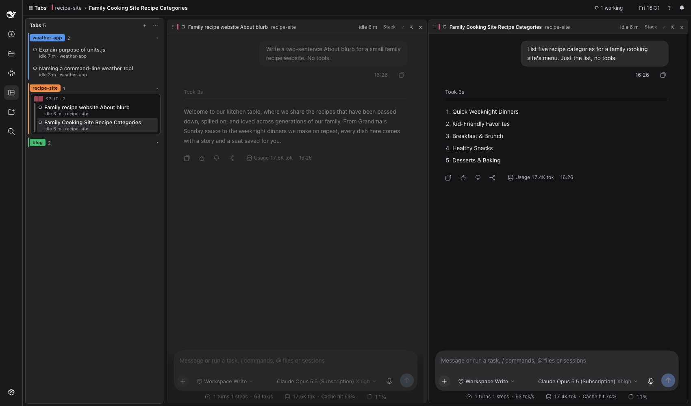

# dsh-tabs

Chrome-style tabs for [DeepSeek Harness](https://github.com/deepseek-ai/deepseek-harness) (DSH)
chat sessions, in the Web GUI.



- **A tab strip in your order.** Opening a chat adds a tab at the end. Only opening, closing and
  dragging change the order; switching tabs never moves one.
- **Vertical or horizontal.** Down the side (drag its edge to resize it, 180–560 px) or along the
  top like a browser.
- **Tab groups.** Each has a name and a colour and can be collapsed. "Group by project" builds
  them from the chats' workspaces.
- **Splits.** A tab holds one session or up to four live panes side by side. Drag a tab onto a
  pane's edge to split it, or onto its centre to replace or swap it.
- **Nothing stops.** Closing a tab only takes it off the strip: the session keeps running in
  DSH's session list (the drawer), and ⌥⇧T reopens it.
- **Notifications.** A bell collects one notification per question from any open tab, and you
  can answer short ones right there. ☾ Focus turns off the banners.
- **Subagents and jobs.** A chip in each pane's header lists them; click a subagent to open it
  beside the pane.

The page appears as **Tabs** in the sidebar. Files, Terminal and file previews open on the
session's normal full page (⤢); **Back to tabs** returns.

## Install

Requires DSH with the Web GUI (`dsh web`).

```sh
dsh plugin --profile web add @vennahlot/dsh-tabs
```

Or from a clone, to hack on it:

```sh
git clone https://github.com/vennahlot/dsh-tabs.git
dsh plugin --profile web add link:$PWD/dsh-tabs
```

Then restart `dsh web` and refresh the page. The bundle adds its own profile row
([`cordis.patch.yml`](cordis.patch.yml)); the only option is `stateFile` (default
`~/.dsh/dsh-tabs/state.json`).

## Shortcuts

| Keys | Action |
|---|---|
| ⌥1 … ⌥8, ⌥9 | Tab n, the last tab |
| ⌥[ ⌥] | Previous / next tab |
| ⌥O | Open a recent chat |
| ⌥W | Close the focused pane |
| ⌥⇧T | Reopen the last closed tab |
| ⌥←↑↓→ | Move focus between panes |
| ⌥F | Full page of the focused pane |
| ⌥B | Show or hide the drawer |
| ⌥N | Notifications |

They also appear in DSH's shortcut reference. **?** on the page explains the mouse actions.

## For other plugins

dsh-tabs declares two slots that other bundles may fill:

| Slot | Kind | Shows |
|---|---|---|
| `tabs.menubar.item` | list, root scope | A small item on the page's menu bar (for example a usage gauge). |
| `tabs.pane.side` | keyed, session scope | A side panel inside a pane, opened from the pane header. |

Inject them with `ctx.slots.inject('<slot>', () => ctx.slots.register({ name: '<slot>', … }, Component))`
so your bundle waits until dsh-tabs is loaded and works without it.

## Development

Plain JavaScript, no build step: [`index.js`](index.js) is the Host half (the state file and its
route) and [`client.js`](client.js) is the Client half (the page). See [DESIGN.md](DESIGN.md) for
how they work.

```sh
npm test        # the pure tab moves (node:test, no dependencies)
npm run check   # syntax check of both halves
```

After a change to `client.js`, refresh the page. A change to `index.js` needs a DSH restart.

## License

[MIT](LICENSE)
